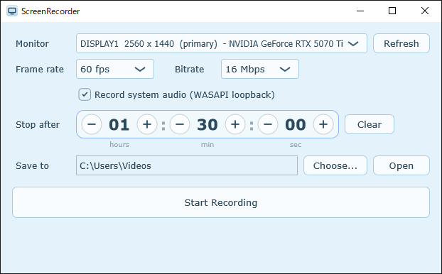

# ScreenRecorder

日本語 | [English](#english)

Windows 用のシンプルなタイマー付き録画アプリです。画面の録画には DXGI Desktop Duplication API を使っています。ウィンドウや GUI などは [JUCE](https://juce.com) を使っています。

## 機能

- モニターを選んで録画（Desktop Duplication API）
- システム音の録音（WASAPI ループバック）
- **タイマー録画** — 録画時間を決めておくと、その時間で自動的に停止して保存
- アプリ自身のウィンドウは録画に映りません
- H.264 / AAC の MP4 で保存（Media Foundation）

### 時間の入れ方

- **− / + ボタン** — 1 ずつ増減します。長押しすると連続して増減します
- **マウスホイール** — 数字の上でホイールを回しても増減できます
- **直接入力** — 数字をダブルクリックすると、キーボードで値を打ち込めます

**00:00:00 のままにすると**、「Stop Recording」を押すまで録画が続きます。

### 録画中の操作

- 録画中でも − / + やホイールで残り時間を延ばしたり縮めたりできます
- 録画中に Clear を押すとタイマーが解除され、手動で止めるまで録画が続きます

## 動作環境

- Windows 10 (2004) 以降 / Windows 11（64bit）
- Windows の「N」エディションでは Media Feature Pack が必要です

## ダウンロード

ビルド済みのアプリは [Releases](../../releases) から入手できます。

## ビルド方法

1. [JUCE](https://github.com/juce-framework/JUCE) 9 を `C:\JUCE` に置く
   （別の場所に置く場合は、Projucer で `ScreenRecorder.jucer` のモジュールパスを変更してください）
2. Visual Studio 2022（「C++ によるデスクトップ開発」ワークロード）をインストール
3. `Builds/VisualStudio2022/ScreenRecorder.sln` を開き、`Release | x64` でビルド

ソースファイルを追加・削除したときは、Projucer で `ScreenRecorder.jucer` を開いて保存し、プロジェクトファイルを再生成してください。

## ライセンス

[GNU Affero General Public License v3.0](LICENSE)

このアプリは JUCE を AGPLv3 の下で使用しています。同梱しているサードパーティ製ソフトウェアのライセンスは [THIRD_PARTY_NOTICES.md](THIRD_PARTY_NOTICES.md) を参照してください。

---

## English

A simple screen recorder for Windows with a built-in recording timer. Screen capture uses the DXGI Desktop Duplication API; the window, GUI and other app-side parts use [JUCE](https://juce.com).

### Features

- Record any monitor (Desktop Duplication API)
- System audio recording (WASAPI loopback)
- Saves as MP4 with H.264 / AAC (Media Foundation)
- **Timer recording** — set a duration and recording stops and saves automatically when it is reached
- The app's own window never appears in the recording

#### Entering a duration

- **− / + buttons** — change the value by 1. Hold to keep changing it
- **Mouse wheel** — scroll over a number to change it
- **Direct input** — double-click a number to type a value

**If you leave it at 00:00:00**, recording continues until you press "Stop Recording".

#### While recording

- You can extend or shorten the remaining time with − / + or the mouse wheel
- Pressing Clear cancels the timer; recording then continues until you stop it manually

### Requirements

- Windows 10 (version 2004) or later / Windows 11 (64-bit)
- "N" editions of Windows require the Media Feature Pack

### Download

Prebuilt binaries are available on the [Releases](../../releases) page.

### Building

1. Place [JUCE](https://github.com/juce-framework/JUCE) 9 at `C:\JUCE`
   (if you put it elsewhere, change the module paths in `ScreenRecorder.jucer` with the Projucer)
2. Install Visual Studio 2022 with the "Desktop development with C++" workload
3. Open `Builds/VisualStudio2022/ScreenRecorder.sln` and build `Release | x64`

When you add or remove source files, open `ScreenRecorder.jucer` in the Projucer and save it to regenerate the project files.

### License

[GNU Affero General Public License v3.0](LICENSE)

This app uses JUCE under the AGPLv3. See [THIRD_PARTY_NOTICES.md](THIRD_PARTY_NOTICES.md) for the licenses of the bundled third-party software.
